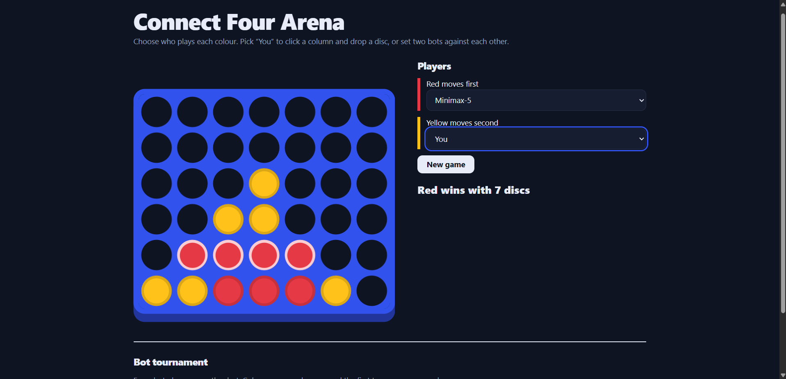
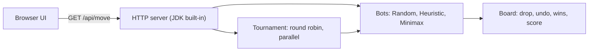

<h1 align="center">Connect Four Arena</h1>
<p align="center"><b>Play a bot, watch two bots battle, or run a full tournament.<br>Pure Java 21 with zero runtime dependencies.</b></p>

<p align="center">
  <a href="https://github.com/Tumioz/connect-four-arena/actions/workflows/ci.yml"></a>
  
  
  
</p>

<p align="center"></p>

## What it does
- **Play** against any bot by clicking a column. Discs drop with a bounce and the winning four pulse.
- **Watch** any two bots play each other. Pick the players from the dropdowns and the game starts by itself.
- **Compete** them in a round-robin tournament and see the standings race across the screen.
- **Extend** it by writing your own bot. It takes one method and one line of registration.

## Quick start
You only need a JDK (21 recommended). No Maven, no downloads.

**Windows (PowerShell)**
```powershell
New-Item -ItemType Directory -Force out | Out-Null
javac -d out (Get-ChildItem src/main/java -Recurse -Filter *.java).FullName
Copy-Item src/main/resources/static out -Recurse -Force
java -cp out arena.Main
```

**macOS and Linux**
```bash
javac -d out $(find src/main/java -name '*.java') && cp -r src/main/resources/static out/
java -cp out arena.Main
```

Then open **http://localhost:8080**. If that port is busy, pass another: `java -cp out arena.Main 8090`.
For a league table in the terminal instead: `java -cp out arena.Main tournament 20`.

## Meet the bots
| Bot | How it thinks | Strength |
|---|---|---|
| **Random** | Plays any legal column | The baseline |
| **Heuristic** | Win if possible, block if necessary, otherwise lean towards the centre | Never misses a one-move win or loss |
| **Minimax-3** | Negamax with alpha-beta pruning, 3 plies deep | Spots traps two moves ahead |
| **Minimax-5** | The same search, 5 plies deep | Sees double threats coming |

Minimax scores open lines of four and rewards the centre column. Centre-first move ordering makes pruning far more effective, and equally good moves are chosen at random so games vary.

## How it fits together


| Endpoint | Purpose |
|---|---|
| `GET /api/bots` | List the available bots |
| `GET /api/move?bot=Minimax-5&moves=3,3,4` | The bot's reply to the moves so far |
| `GET /api/tournament?games=10` | Round-robin standings (games per pairing, max 40) |

## Tests
39 JUnit 5 tests. Run them with `mvn test`, or open `pom.xml` in IntelliJ or VS Code and run them from there.

| Suite | Tests | What it proves |
|---|---|---|
| `BoardTest` | 15 | Wins in all four directions, undo, move ordering, scoring invariants |
| `BotsTest` | 10 | Legal moves, board left untouched, win and block, double-threat tactic, strength ordering |
| `TournamentTest` | 7 | Game accounting, fair colour swapping, ranking, edge cases |
| `ApiTest` | 7 | The real HTTP server on a free port: endpoints, errors and the page |

GitHub Actions runs the whole suite on every push.

## Design decisions
1. **One-method `Bot` interface.** A new bot is one class and one line in `Bots`.
2. **Fair tournaments.** Colours swap every game and the first two moves are random, so repeated games differ and the first-move advantage cancels out.
3. **Stateless API.** The client sends the moves so far and the server replays them. There is no session to leak or expire.
4. **Mutable board with drop and undo.** Search stays fast because nothing is copied. Bots must leave the board as they found it, and a test enforces that.
5. **No framework.** The JDK server and plain JavaScript keep the project easy to read, run and review.

## Roadmap
- [ ] Iterative deepening with a time limit
- [ ] Transposition table
- [ ] Monte Carlo tree search bot
- [ ] Elo ratings across tournaments
- [ ] Bitboard representation for speed

## Inspiration
Built in the spirit of the Entelect Challenge, where you write a bot and strategy decides the winner.
